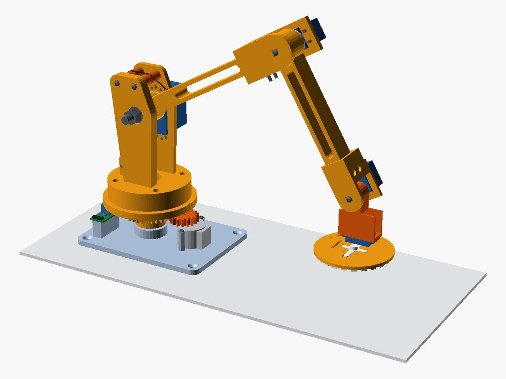

# Braccio robotico da banco stampato in 3D con telecamera, con Raspberry Pi 4 e controllo da Claude AI

> 📖 **Articoli completi con spiegazioni passo passo:**  
> **[Braccio robotico da banco con telecamera, Raspberry Pi 4 e Claude AI - www.emgi.it](https://www.emgi.it/2026/10/19/braccio-robotico-telecamera-raspberry-pi-stampato-3d/)** (braccio e opzione display)  
> **[Controller con joystick per il braccio robotico - www.emgi.it](https://www.emgi.it/2026/10/23/controller-joystick-braccio-robotico-arduino-nano/)** (opzione controller)
>
> Altri progetti di elettronica, Arduino, ESP32, Home Assistant e stampa 3D su **[www.emgi.it](https://www.emgi.it)**

Un **braccio a cinque assi** stampato in PETG che muove la camera da 8 MP di un **Raspberry Pi 4** sul banco di lavoro. Si comanda da una **pagina web** o da **Claude AI**, che tramite un server MCP può inquadrare il banco, guardare le foto e registrare video. Due aggiunte sono opzionali: un **display LCD 16×2** di stato e un **controller con due joystick**.

## Le tre parti

| Cartella | Cosa contiene | Serve? |
|---|---|---|
| [`braccio/`](braccio/) | Braccio, scatola dell'elettronica, software del Raspberry (pagina web, server MCP per Claude, go2rtc, manutenzione) | **sì** |
| [`display/`](display/) | Display LCD 16×2 I2C con traslatore BSS138, scatolina stampata, programma `display_lcd.py` | opzionale |
| [`controller/`](controller/) | Console con Arduino Nano, 2 joystick KY-023 e 4 pulsanti, collegata al Pi via USB | opzionale |

Ogni cartella ha il suo README con componenti, **collegamenti elettrici**, STL, sorgenti OpenSCAD, software, guida di montaggio (pagina HTML) e schema dei collegamenti.

## Cosa fa

- **cinque movimenti**: base rotante (passo-passo 28BYJ-48 con azzeramento a sensore Hall), spalla e gomito (MG996R 180°), tilt e rotazione della camera (MG90S)
- **servo pilotati dalla PCA9685** in I2C: niente tremolii
- **video live nel browser** con comandi a frecce, zoom digitale ×8, **foto** fino a 8 MP, **registrazione video** MP4
- **anello di 24 LED WS2812B** attorno all'obiettivo
- **posizioni salvate** e pagina di **taratura**
- **server MCP per Claude**: stato, movimenti, luce, foto, video, posizioni, messaggi sul display; giunti bloccabili
- **go2rtc**: video H.264 con l'encoder hardware del Pi, RTSP per VLC e Home Assistant
- **manutenzione**: watchdog, backup giornaliero (locale + NAS), aggiornamenti di sicurezza automatici

## Come si comincia

1. Stampa e monta il braccio con la guida in [`braccio/documentazione/`](braccio/documentazione/) (scaricala e aprila nel browser).
2. Collega l'elettronica secondo lo schema e installa il software: [`braccio/software/LEGGIMI.txt`](braccio/software/LEGGIMI.txt).
3. Se vuoi, aggiungi il display e/o il controller.

💡 **Non serve saper programmare: chiedi a Claude.** Allega i file a una chat con Claude e chiedigli le procedure un passo alla volta: installazione, collaudo, chiave SSH, collegamento MCP, backup sul NAS, go2rtc e Home Assistant. I dati personali sono stati sostituiti da **segnaposto in maiuscolo** (`TUO_UTENTE`, `IP_DEL_PI`, `TUO_UTENTE_WINDOWS`, dati del NAS).

Costo indicativo del braccio **120-150 €**: dipende da dove si compra (Amazon, oppure AliExpress con dazi sugli ordini singoli o senza dazi con le offerte a pacchetto).

## Crediti

- [CamUI](https://github.com/monkeymademe/CamUI) di James Mitchell - interfaccia web per la camera
- [go2rtc](https://github.com/AlexxIT/go2rtc) di Alexey Khit - conversione e distribuzione dello stream

## Licenza

- Codice e configurazioni: [MIT](LICENSE)
- Modelli 3D, schemi, guide e immagini: [CC BY-SA 4.0](https://creativecommons.org/licenses/by-sa/4.0/deed.it)

---

**Autore:** Massimiliano Sandrin - **[eMGi.it](https://www.emgi.it)** · Domande e commenti sotto gli articoli sul sito.
