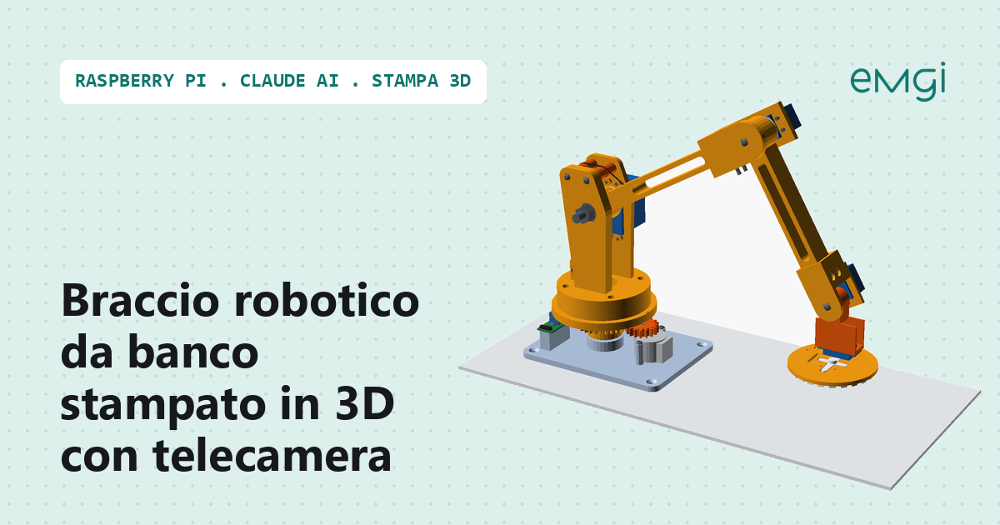
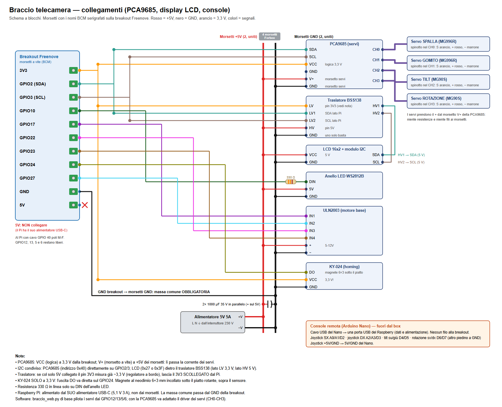

# Braccio robotico da banco stampato in 3D con telecamera, con Raspberry Pi 4 e controllo da Claude AI

> 📖 **Articolo completo con spiegazioni passo passo:**  
> **[Braccio robotico da banco stampato in 3D con telecamera, con Raspberry Pi 4 e controllo da Claude AI - www.emgi.it](https://www.emgi.it/2026/10/19/braccio-robotico-telecamera-raspberry-pi-stampato-3d/)**
>
> Altri progetti di elettronica, Arduino, ESP32, Home Assistant e stampa 3D su **[www.emgi.it](https://www.emgi.it)**

Un **braccio a cinque assi** stampato in PETG che muove la camera da 8 MP di un **Raspberry Pi 4** sul banco di lavoro. Si comanda dal browser, da una **console con due joystick** o da **Claude AI**, che tramite un server MCP può inquadrare il banco, guardare le foto e registrare video.

## Cosa fa il progetto

- **cinque movimenti**: rotazione della base, spalla, gomito, inclinazione (tilt) e rotazione della camera
- **video live nel browser** con comandi a frecce (tieni premuto = movimento, rilasci = stop; si ferma da solo se la connessione cade)
- **zoom digitale** fino a ×8 e **foto** fino a 8 MP a sensore pieno
- **registrazione video** in MP4 con un pulsante, senza ricodifica (via go2rtc)
- **anello di 24 LED WS2812B** attorno all'obiettivo, con livello e colore regolabili
- **posizioni salvate** da richiamare con un clic
- **azzeramento della base** con sensore Hall KY-024 e magnete
- **console remota** (Arduino Nano via USB) e **display LCD 16×2** di stato
- **server MCP** per Claude: stato, movimenti, luce, foto, video, posizioni, messaggi sul display; giunti bloccabili per sicurezza
- **go2rtc**: video H.264 con l'encoder hardware del Pi, RTSP per VLC e Home Assistant
- **manutenzione**: watchdog, backup giornaliero (locale + NAS), aggiornamenti di sicurezza automatici

## Componenti utilizzati

- Raspberry Pi 4 + camera v2 **IMX219** 8 MP, con il suo alimentatore 5,1 V 3 A
- 2 servo **MG996R da 180°** (spalla, gomito) - non quelli a rotazione continua (360°)
- 2 servo **MG90S** (tilt e rotazione della camera)
- motore passo-passo **28BYJ-48** + driver **ULN2003** (base, pignone da 17 denti)
- scheda **PCA9685** 16 canali PWM I2C per i servo
- sensore Hall **KY-024** + **magnete al neodimio 6×3 mm**
- anello **WS2812B 24 LED** + resistenza 330 Ω
- alimentatore **5 V 5 A**, interruttore a bilanciere 230 V, 2 condensatori 1000 µF 35 V
- breakout GPIO **Freenove** + cavo 40 poli
- traslatore di livello **BSS138** 4 canali (solo per l'LCD)
- **4 morsetti Forbox** per +5 V e GND
- **LCD 16×2** con modulo I2C PCF8574
- **Arduino Nano**, 2 joystick **KY-023**, 4 pulsanti 12×12 con tappo 10×10
- 3 cuscinetti 608, 2 molle 7×51 mm, cordino 0,5 mm, viteria M3 a testa tonda + 2 perni M8
- filamento **PETG**

Costo indicativo **120-150 €**: dipende da dove si compra (Amazon, oppure AliExpress con dazi sugli ordini singoli o senza dazi con le offerte a pacchetto).

## Collegamenti elettrici

Schema completo: [`documentazione/schema_collegamenti.png`](documentazione/schema_collegamenti.png) (anche in [SVG](documentazione/schema_collegamenti.svg)).

| Breakout GPIO (BCM) | Collegato a |
|---|---|
| GPIO2 (SDA) / GPIO3 (SCL) | PCA9685 direttamente; LCD passando dal traslatore BSS138 (LV1/LV2 → HV1/HV2) |
| GPIO10 (SPI MOSI) | DIN dell'anello LED, con 330 Ω in serie |
| GPIO17 / 27 / 22 / 23 | IN1 / IN2 / IN3 / IN4 dell'ULN2003 |
| GPIO24 | DO del KY-024 |
| 3V3 | VCC logica PCA9685, VCC KY-024, LV del traslatore |
| GND | morsetti GND (**massa comune obbligatoria**) |
| 5V | **non collegato**: il Pi ha il suo alimentatore |

| PCA9685 | Servo |
|---|---|
| CH0 | spalla (MG996R) |
| CH1 | gomito (MG996R) |
| CH2 | tilt (MG90S) |
| CH3 | rotazione (MG90S) |

| Alimentazione 5 V 5 A (morsetti +5 V / GND) | |
|---|---|
| V+ della PCA9685 | corrente dei servo |
| ULN2003 +/- | motore della base |
| anello LED 5V/GND | |
| LCD VCC/GND e lato HV del BSS138 | |
| 2 × 1000 µF 35 V in parallelo | vicino ai morsetti |

Note:
- **KY-024 solo a 3,3 V**: la sua uscita va diretta su un GPIO.
- **Traslatore BSS138**: alimentalo prima solo dal lato 5 V e misura il pin 3V3; se trovi già ~3,3 V ha un regolatore a bordo e il 3V3 del Pi va lasciato scollegato.
- La **console** si collega solo con il cavo USB del Nano a una porta USB del Raspberry. Joystick sinistro A0/A1/D2, destro A2/A3/D3, pulsanti tilt D4/D5 e rotazione D6/D7 verso GND (`INPUT_PULLUP`).
- Il software del pacchetto pilota i servo **direttamente dai GPIO** del Pi (spalla 12, gomito 13 in PWM hardware; tilt 5, rotazione 6). Con la PCA9685 va adattato il driver dei servo (canali della tabella sopra).

## Contenuto del repository

| Percorso | Contenuto |
|---|---|
| `stl/` | Tutti i pezzi da stampare, divisi in cartelle nell'ordine di montaggio (il rullo della spalla in 2 copie) |
| `openscad/` | Sorgenti parametrici OpenSCAD dei pezzi |
| `documentazione/guida_montaggio.html` | Guida di montaggio in 19 passi con disegni 3D, pezzi e viti (si apre nel browser) |
| `documentazione/schema_collegamenti.*` | Schema a blocchi dei collegamenti |
| `software/` | Software per Raspberry Pi e Arduino Nano, servizi, go2rtc, server MCP, manutenzione - vedi [`software/LEGGIMI.txt`](software/LEGGIMI.txt) |
| `immagini/` | Immagini dell'articolo |

## Come si usa

1. Stampa i pezzi in PETG e monta il braccio seguendo la [guida di montaggio](documentazione/guida_montaggio.html) (scaricala e aprila nel browser).
2. Collega l'elettronica secondo lo schema.
3. Sul Raspberry Pi (Raspberry Pi OS Bookworm o successivo) installa **CamUI** (`git clone https://github.com/monkeymademe/CamUI.git`), poi il software di [`software/`](software/): file, pacchetti e configurazione sono descritti in [`software/LEGGIMI.txt`](software/LEGGIMI.txt).
4. Sostituisci i **segnaposto in maiuscolo** (`TUO_UTENTE`, `IP_DEL_PI`, `TUO_UTENTE_WINDOWS`, dati del NAS) con i tuoi. Le password scrivile tu sul Raspberry, non negli script.
5. Apri `http://IP-del-Pi:8091`, fai **Home base** e la **taratura** di ogni servo (zero, verso, limiti) con piccoli movimenti.
6. Facoltativo: collega il server MCP a Claude Desktop con [`software/claude_desktop/claude_desktop_config_esempio.json`](software/claude_desktop/claude_desktop_config_esempio.json).

💡 **Non serve saper programmare: chiedi a Claude.** Allega i file a una chat con Claude e chiedigli le procedure un passo alla volta: installazione, collaudo, chiave SSH, collegamento MCP, backup sul NAS, go2rtc e Home Assistant, adattamento alla PCA9685.

⚠️ L'accesso SSH con `sudo` dà a Claude il controllo completo del Raspberry: usa una chiave dedicata, non condividerla e toglila quando non serve.

Dettagli, scelte di progetto e risoluzione dei problemi: **[articolo su www.emgi.it](https://www.emgi.it/2026/10/19/braccio-robotico-telecamera-raspberry-pi-stampato-3d/)**.

## Crediti

- [CamUI](https://github.com/monkeymademe/CamUI) di James Mitchell - interfaccia web per la camera
- [go2rtc](https://github.com/AlexxIT/go2rtc) di Alexey Khit - conversione e distribuzione dello stream

## Licenza

- Codice e configurazioni: [MIT](LICENSE)
- Modelli 3D, schemi, guida e immagini: [CC BY-SA 4.0](https://creativecommons.org/licenses/by-sa/4.0/deed.it)

---

**Autore:** Massimiliano Sandrin - **[eMGi.it](https://www.emgi.it)** · Domande e commenti sotto l'[articolo sul sito](https://www.emgi.it/2026/10/19/braccio-robotico-telecamera-raspberry-pi-stampato-3d/).
