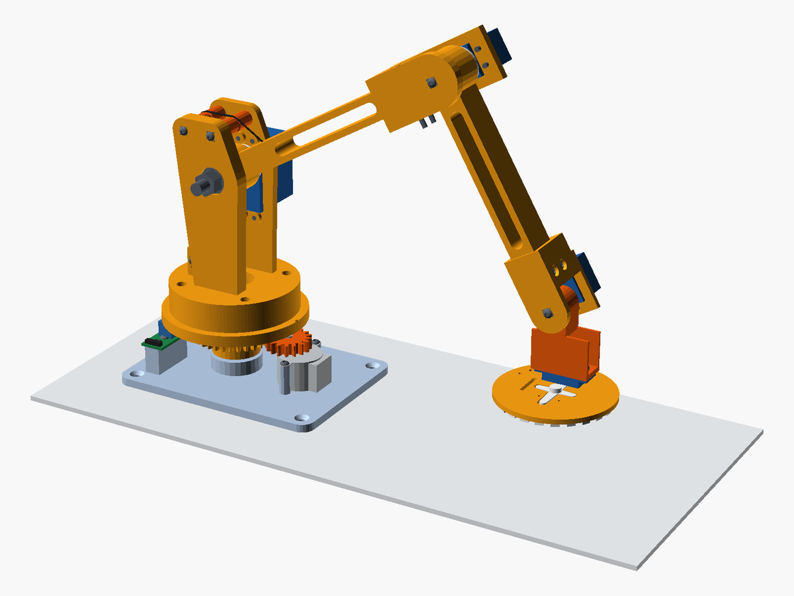
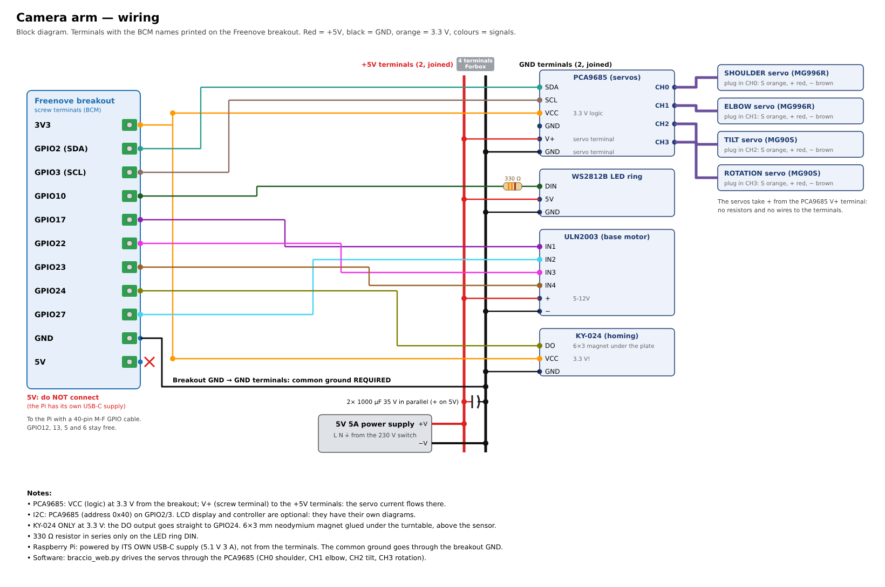
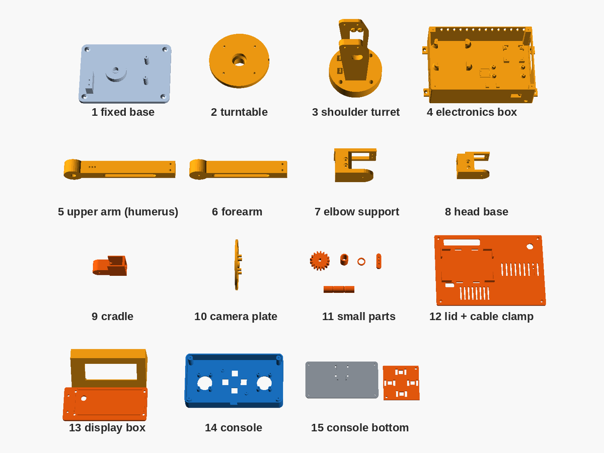

# Arm

> 📖 **[Full article on www.emgi.it (in Italian)](https://www.emgi.it/2026/10/19/braccio-robotico-telecamera-raspberry-pi-stampato-3d/)** · [back to the project](../README.md)

## Components

- Raspberry Pi 4 + camera v2 **IMX219** 8 MP, with its 5.1 V 3 A power supply
- 2 **180° MG996R** servos (shoulder, elbow) - not the continuous rotation (360°) ones
- 2 **MG90S** servos (camera tilt and rotation)
- **28BYJ-48** stepper motor + **ULN2003** driver (base, 17-tooth pinion)
- **PCA9685** 16-channel PWM I2C board
- **KY-024** Hall sensor + **6×3 mm neodymium magnet**
- **WS2812B 24-LED** ring + 330 Ω resistor
- **5 V 5 A** power supply, 230 V rocker switch, 2 × 1000 µF 35 V capacitors
- **Freenove** GPIO breakout + 40-pin cable
- **4 Forbox terminals** for +5 V and GND
- 3 × 608 bearings, 2 × 7×51 mm springs, 0.5 mm cord, M3 button-head screws + 2 M8 bolts
- **PETG** filament

## Wiring

| GPIO breakout (BCM) | Connected to |
|---|---|
| GPIO2 (SDA) / GPIO3 (SCL) | SDA / SCL of the PCA9685 |
| GPIO10 (SPI MOSI) | DIN of the LED ring, with 330 Ω in series |
| GPIO17 / 27 / 22 / 23 | IN1 / IN2 / IN3 / IN4 of the ULN2003 |
| GPIO24 | DO of the KY-024 |
| 3V3 | PCA9685 logic VCC, KY-024 VCC |
| GND | GND terminals (**common ground required**) |
| 5V | **not connected**: the Pi has its own power supply |

| PCA9685 | Servo |
|---|---|
| CH0 | shoulder (MG996R) |
| CH1 | elbow (MG996R) |
| CH2 | tilt (MG90S) |
| CH3 | rotation (MG90S) |

| +5 V / GND terminals (5 V 5 A power supply) | |
|---|---|
| V+ and GND of the PCA9685 (screw terminal) | servo current |
| ULN2003 + / − | base motor |
| LED ring 5V / GND | |
| KY-024 GND | (VCC at 3.3 V from the breakout) |
| 2 × 1000 µF 35 V in parallel | + on 5 V |

Notes:
- **KY-024 at 3.3 V only**: its output goes straight to a GPIO.
- **Raspberry Pi** powered by its own USB-C supply, not from the terminals; the common ground goes through the breakout GND.
- The box already has the seat for the BSS138 level shifter, needed only if you fit the [display](../display/).

## Contents

| Path | Content |
|---|---|
| `stl/` | Parts to print in folders in assembly order (the shoulder roller in 2 copies) |
| `openscad/` | Parametric OpenSCAD sources |
| `docs/assembly_guide.html` | 17-step assembly guide with 3D drawings, parts, screws and wiring (opens in the browser) |
| `docs/wiring_diagram.*` | Wiring block diagram |
| `software/` | Raspberry software and Claude Desktop configuration - see [`software/README.txt`](software/README.txt) |

## Software

- `software/raspberry/opt/braccio/braccio_web.py` + `ui/index.html`: server and web page (port 8091). Servos on the PCA9685; alternatively, in `config.json`, on the GPIOs (`"tipo": "hw"` or `"sw"`).
- `software/raspberry/braccio_mcp/`: MCP server for Claude, with the lockable joints in `mcp.json`.
- `software/raspberry/go2rtc/` and `systemd/`: H.264 video, RTSP and recording; automatic start of braccio-web, CamUI and go2rtc.
- `software/raspberry/maintenance/`: daily backup (local + NAS), watchdog, security updates.
- `software/claude_desktop/`: two Claude Desktop configurations (direct ssh, or `avvio_braccio.py`, which gives no errors when the Pi is off).
- Camera: [CamUI](https://github.com/monkeymademe/CamUI) (`git clone https://github.com/monkeymademe/CamUI.git ~/CamUI`).

After installation open `http://PI-IP:8091`, do **Home base** and the **calibration** of each servo (zero, direction, limits) with small movements.

Safety of the movements (`braccio_web.py`, last modified 15/11/2026):
- **STOP** stops the base, the automatic lift for the box zone and HOME; shoulder and elbow stay where they are.
- **Box zone** (base within ±25°: shoulder ≥ 70°, elbow ≥ 60°) checked at every base step: if the destination changes halfway, the base stops at the edge, lifts the arm and then goes on.
- After **Release** (and at every service start) shoulder and elbow are treated as "unknown position": before entering the zone they are powered again and lifted.
- **One owner of the base motor**: a second HOME is refused ("HOME already in progress"), base commands are refused during HOME.
- **Calibration** (`/api/config`) checks every value; a wrong **light colour** is refused; a corrupted `config.json` is replaced by the last valid backup (`config.json.bak`), never by the factory values; `stato.json` is saved every 2 s while the base turns.
- **Idle mode**: light off after 5 min, `casa` preset after 60 min, Raspberry shutdown after 120 min without commands (section `"riposo"` in `config.json`: `luce_min`, `casa_min`, `spegni_min`).

⚠️ SSH access with `sudo` gives Claude full control of the Raspberry: use a dedicated key, do not share it and remove it when not needed.
