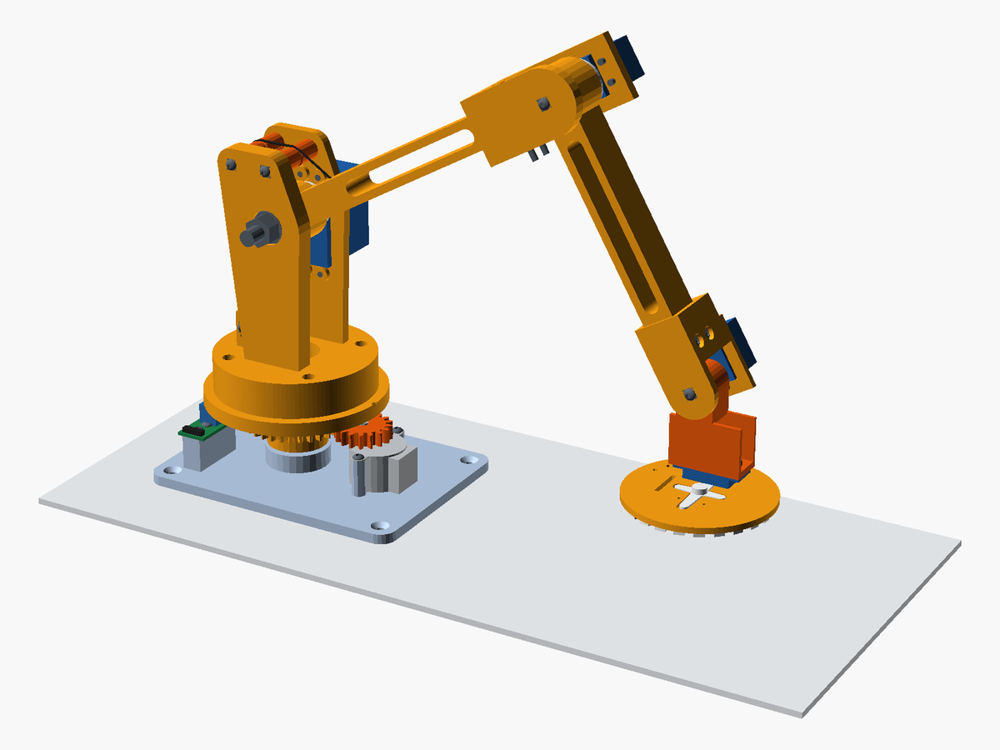
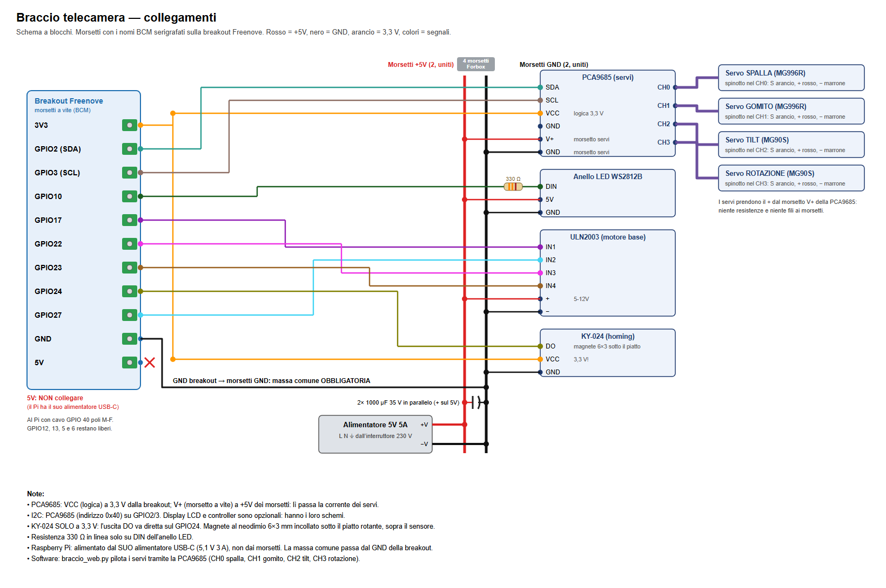

# Braccio

> 📖 **[Articolo completo su www.emgi.it](https://www.emgi.it/2026/10/19/braccio-robotico-telecamera-raspberry-pi-stampato-3d/)** · [torna al progetto](../README.md)

## Componenti

- Raspberry Pi 4 + camera v2 **IMX219** 8 MP, con il suo alimentatore 5,1 V 3 A
- 2 servo **MG996R da 180°** (spalla, gomito) - non quelli a rotazione continua (360°)
- 2 servo **MG90S** (tilt e rotazione della camera)
- motore passo-passo **28BYJ-48** + driver **ULN2003** (base, pignone da 17 denti)
- scheda **PCA9685** 16 canali PWM I2C
- sensore Hall **KY-024** + **magnete al neodimio 6×3 mm**
- anello **WS2812B 24 LED** + resistenza 330 Ω
- alimentatore **5 V 5 A**, interruttore a bilanciere 230 V, 2 condensatori 1000 µF 35 V
- breakout GPIO **Freenove** + cavo 40 poli
- **4 morsetti Forbox** per +5 V e GND
- 3 cuscinetti 608, 2 molle 7×51 mm, cordino 0,5 mm, viteria M3 a testa tonda + 2 perni M8
- filamento **PETG**

## Collegamenti elettrici

| Breakout GPIO (BCM) | Collegato a |
|---|---|
| GPIO2 (SDA) / GPIO3 (SCL) | SDA / SCL della PCA9685 |
| GPIO10 (SPI MOSI) | DIN dell'anello LED, con 330 Ω in serie |
| GPIO17 / 27 / 22 / 23 | IN1 / IN2 / IN3 / IN4 dell'ULN2003 |
| GPIO24 | DO del KY-024 |
| 3V3 | VCC logica della PCA9685, VCC del KY-024 |
| GND | morsetti GND (**massa comune obbligatoria**) |
| 5V | **non collegato**: il Pi ha il suo alimentatore |

| PCA9685 | Servo |
|---|---|
| CH0 | spalla (MG996R) |
| CH1 | gomito (MG996R) |
| CH2 | tilt (MG90S) |
| CH3 | rotazione (MG90S) |

| Morsetti +5 V / GND (alimentatore 5 V 5 A) | |
|---|---|
| V+ e GND della PCA9685 (morsetto a vite) | corrente dei servo |
| ULN2003 + / − | motore della base |
| anello LED 5V / GND | |
| KY-024 GND | (VCC a 3,3 V dalla breakout) |
| 2 × 1000 µF 35 V in parallelo | + sul 5 V |

Note:
- **KY-024 solo a 3,3 V**: la sua uscita va diretta su un GPIO.
- **Raspberry Pi** alimentato dal suo alimentatore USB-C, non dai morsetti; la massa comune passa dal GND della breakout.
- Nella scatola c'è già l'alloggiamento del traslatore BSS138, che serve solo se monti il [display](../display/).

## Contenuto

| Percorso | Contenuto |
|---|---|
| `stl/` | Pezzi da stampare in cartelle nell'ordine di montaggio (il rullo della spalla in 2 copie) |
| `openscad/` | Sorgenti parametrici OpenSCAD |
| `documentazione/guida_montaggio.html` | Guida di montaggio in 17 passi con disegni 3D, pezzi, viti e collegamenti (si apre nel browser) |
| `documentazione/schema_collegamenti.*` | Schema a blocchi dei collegamenti |
| `software/` | Software del Raspberry e configurazione di Claude Desktop - vedi [`software/LEGGIMI.txt`](software/LEGGIMI.txt) |

## Software

- `software/raspberry/opt/braccio/braccio_web.py` + `ui/index.html`: server e pagina web (porta 8091). Servo sulla PCA9685; in alternativa, in `config.json`, sui GPIO (`"tipo": "hw"` o `"sw"`).
- `software/raspberry/braccio_mcp/`: server MCP per Claude, con i giunti bloccabili in `mcp.json`.
- `software/raspberry/go2rtc/` e `systemd/`: video H.264, RTSP e registrazione; avvio automatico di braccio-web, CamUI e go2rtc.
- `software/raspberry/manutenzione/`: backup giornaliero (locale + NAS), watchdog, aggiornamenti di sicurezza.
- `software/claude_desktop/`: due configurazioni di Claude Desktop (ssh diretto, oppure `avvio_braccio.py` che non dà errori quando il Pi è spento).
- Camera: [CamUI](https://github.com/monkeymademe/CamUI) (`git clone https://github.com/monkeymademe/CamUI.git ~/CamUI`).

Dopo l'installazione apri `http://IP-del-Pi:8091`, fai **Home base** e la **taratura** di ogni servo (zero, verso, limiti) con piccoli movimenti.

⚠️ L'accesso SSH con `sudo` dà a Claude il controllo completo del Raspberry: usa una chiave dedicata, non condividerla e toglila quando non serve.
