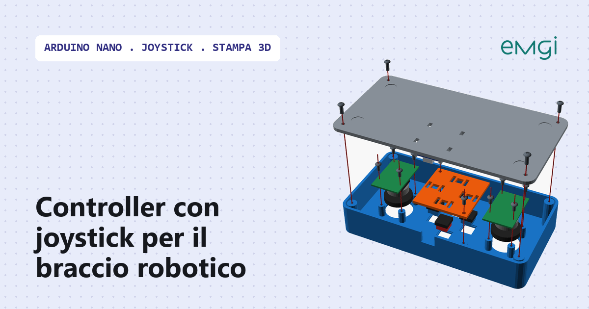
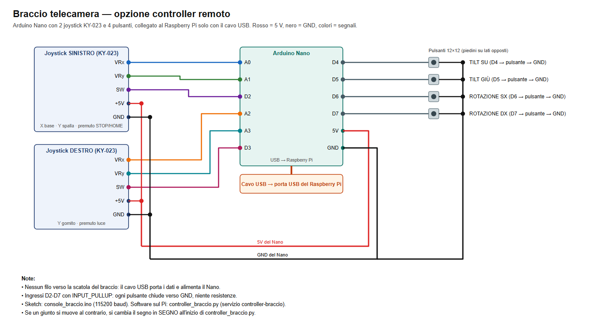

# Controller remoto con joystick (opzionale)

> 📖 **[Articolo completo su www.emgi.it](https://www.emgi.it/2026/10/23/controller-joystick-braccio-robotico-arduino-nano/)** · [torna al progetto](../README.md)

Una console da banco con **due joystick KY-023**, **quattro pulsanti** e un **Arduino Nano**, collegata al Raspberry del braccio con un solo **cavo USB**. Nessun filo verso la scatola dell'elettronica.

| Comando | Cosa fa |
|---|---|
| Joystick sinistro | X = base, Y = spalla; premuto breve = STOP, tenuto 2 s = HOME base |
| Joystick destro | Y = gomito; premuto = luce accesa / spenta |
| Pulsanti a croce | su/giù = tilt della camera, sinistra/destra = rotazione |

## Componenti

- Arduino Nano + cavo USB
- 2 joystick KY-023
- 4 pulsanti 12×12×7,3 mm + tappi quadrati 10×10
- contenitore stampato in 3D (guscio, fondo, piastrina pulsanti)
- viti M3×6 (10), M3×8 (4), 2 fascette, 4 piedini adesivi

## Collegamenti elettrici

| Componente | Arduino Nano |
|---|---|
| Joystick sinistro VRx / VRy / SW | A0 / A1 / D2 |
| Joystick destro VRx / VRy / SW | A2 / A3 / D3 |
| Joystick +5V / GND | 5V / GND |
| Pulsante tilt su / giù | D4 / D5 (altro piedino a GND) |
| Pulsante rotazione sx / dx | D6 / D7 (altro piedino a GND) |
| Nano | cavo USB → porta USB del Raspberry Pi |

Ingressi con `INPUT_PULLUP`: niente resistenze. Usa due piedini su lati opposti dei pulsanti 12×12.

## Contenuto

| Percorso | Contenuto |
|---|---|
| `stl/` | Guscio (si stampa capovolto), fondo e piastrina |
| `openscad/console_braccio.scad` | Sorgente parametrico (`joy_fori`, `joy_alt` da misurare sui propri KY-023) |
| `documentazione/guida_montaggio_controller.html` | Guida di montaggio con collegamenti |
| `software/arduino/console_braccio/console_braccio.ino` | Sketch del Nano (115200 baud, riga `J,a0,a1,a2,a3,pulsanti`) |
| `software/raspberry/controller_braccio.py` + `controller-braccio.service` | Programma sul Pi - vedi [`software/LEGGIMI.txt`](software/LEGGIMI.txt) |

Installazione in breve: carica lo sketch, `sudo apt install python3-serial`, copia `controller_braccio.py` in `/opt/braccio/` e il servizio in `/etc/systemd/system/`, poi `sudo systemctl enable --now controller-braccio`. Se un giunto va al contrario, cambia `SEGNO` in cima a `controller_braccio.py`. Se c'è anche il [display](../display/), mostra STOP, HOME e luce.
