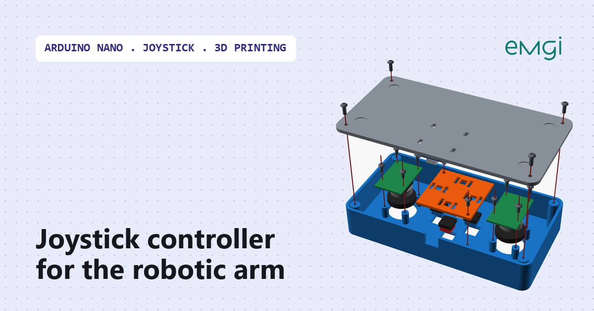
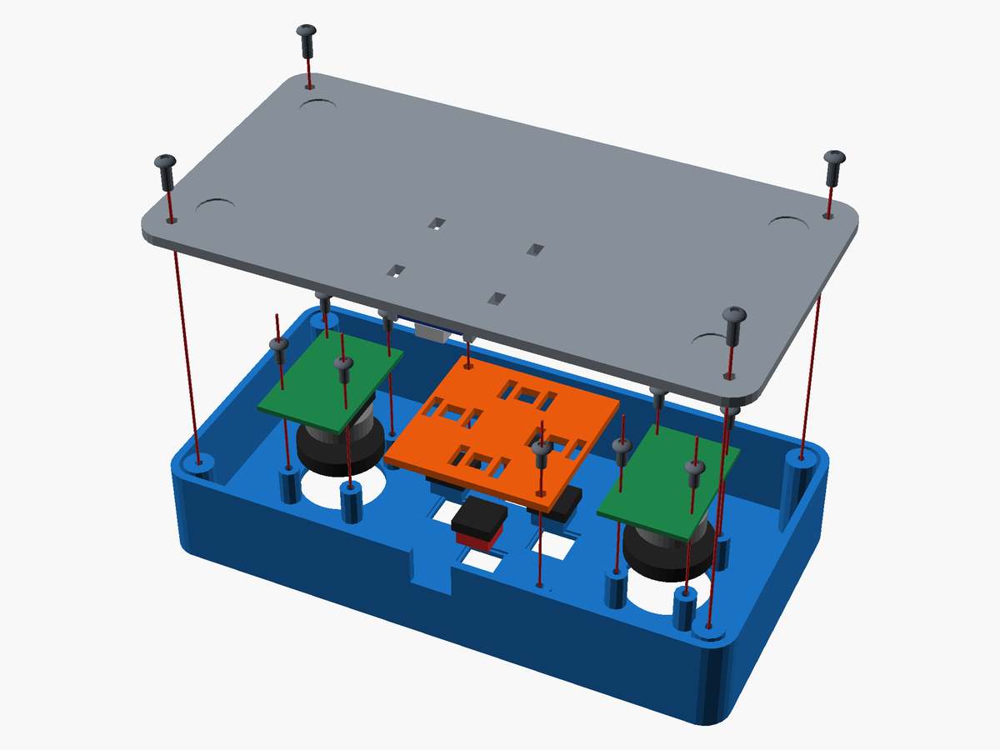

# Remote joystick controller (optional)

> 📖 **[Full article on www.emgi.it (in Italian)](https://www.emgi.it/2026/10/23/controller-joystick-braccio-robotico-arduino-nano/)** · [back to the project](../README.md)

A bench console with **two KY-023 joysticks**, **four buttons** and an **Arduino Nano**, connected to the arm Raspberry with a single **USB cable**. No wires to the electronics box.

| Control | What it does |
|---|---|
| Left joystick | X = base, Y = shoulder; short press = STOP, held 2 s = HOME base |
| Right joystick | Y = elbow; press = light on / off |
| Cross buttons | up/down = camera tilt, left/right = rotation |

## Components

- Arduino Nano + USB cable
- 2 KY-023 joysticks
- 4 × 12×12×7.3 mm buttons + 10×10 square caps
- 3D-printed enclosure (shell, bottom, button plate)
- M3×6 (10) and M3×8 (4) screws, 2 cable ties, 4 adhesive feet

## Wiring

| Component | Arduino Nano |
|---|---|
| Left joystick VRx / VRy / SW | A0 / A1 / D2 |
| Right joystick VRx / VRy / SW | A2 / A3 / D3 |
| Joysticks +5V / GND | 5V / GND |
| Tilt up / down button | D4 / D5 (other pin to GND) |
| Rotate left / right button | D6 / D7 (other pin to GND) |
| Nano | USB cable → Raspberry Pi USB port |

Inputs with `INPUT_PULLUP`: no resistors. Use two pins on opposite sides of the 12×12 buttons.

## Contents

| Path | Content |
|---|---|
| `stl/console/` | Shell (printed upside down), bottom and button plate |
| `openscad/arm_console.scad` | Parametric source (`joy_fori`, `joy_alt` to be measured on your own KY-023) |
| `docs/controller_assembly_guide.html` | Assembly guide with wiring |
| `software/arduino/arm_console/arm_console.ino` | Nano sketch (115200 baud, line `J,a0,a1,a2,a3,buttons`) |
| `software/raspberry/controller_braccio.py` + `controller-braccio.service` | Program on the Pi - see [`software/README.txt`](software/README.txt) |

Quick installation: upload the sketch, `sudo apt install python3-serial`, copy `controller_braccio.py` to `/opt/braccio/` and the service to `/etc/systemd/system/`, then `sudo systemctl enable --now controller-braccio`. If a joint moves the wrong way, change `SEGNO` at the top of `controller_braccio.py`. If the [display](../display/) is also fitted, it shows STOP, HOME and light.
