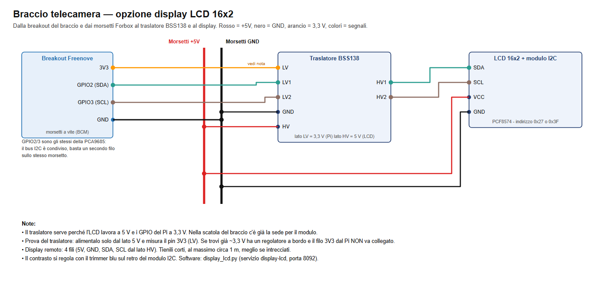

# Display LCD 16×2 (opzionale)

> 📖 **[Articolo su www.emgi.it](https://www.emgi.it/2026/10/19/braccio-robotico-telecamera-raspberry-pi-stampato-3d/)** (sezione «Opzione: display LCD 16×2») · [torna al progetto](../README.md)

Un display LCD 16×2 I2C che mostra la posizione dei giunti, la luce e i messaggi di Claude e del controller. Si monta sul coperchio della scatola dell'elettronica, **fisso** (2 viti) o **orientabile** (1 vite sola, per ruotarlo leggermente), dopo aver forato il coperchio, oppure **remoto** con fili lunghi fino a circa 1 m.

## Componenti

- LCD 16×2 HD44780 + modulo I2C **PCF8574** (indirizzo 0x27 o 0x3F), alimentato a 5 V
- traslatore di livello I2C **BSS138** 4 canali (l'LCD lavora a 5 V, i GPIO del Pi a 3,3 V)
- scatolina stampata in 3D (guscio + fondo), viti M3×6 (4) e M3×8 (4), 1-2 viti M3 per fissarla
- 4 fili

## Collegamenti elettrici

| Da | A |
|---|---|
| GPIO2 (SDA) / GPIO3 (SCL) della breakout | LV1 / LV2 del traslatore (stessi morsetti della PCA9685: bus I2C condiviso) |
| 3V3 della breakout | LV del traslatore, **solo se il modulo non ha già un regolatore** |
| Morsetti +5V | HV del traslatore, VCC del modulo LCD |
| Morsetti GND | GND del traslatore, GND dell'LCD |
| HV1 / HV2 del traslatore | SDA / SCL del modulo LCD |

⚠️ **Prova del traslatore**: alimentalo solo dal lato 5 V e misura il pin LV. Se trovi già ~3,3 V ha un regolatore a bordo: il filo 3V3 dal Pi non va collegato.

## Contenuto

| Percorso | Contenuto |
|---|---|
| `stl/` | Guscio e fondo della scatolina |
| `openscad/box_elettronica.scad` | Sorgente (parti `display_guscio` e `display_fondo`, nello stesso file della scatola) |
| `documentazione/guida_montaggio_display.html` | Guida di montaggio con collegamenti e posizionamento |
| `software/display_lcd.py` + `display-lcd.service` | Programma del display (porta 8092: `GET /lcd?r1=&r2=&sec=`) - vedi [`software/LEGGIMI.txt`](software/LEGGIMI.txt) |

Installazione in breve: I2C attivo, `sudo apt install python3-smbus2`, copia `display_lcd.py` in `/opt/braccio/` e il servizio in `/etc/systemd/system/`, poi `sudo systemctl enable --now display-lcd`. Il contrasto si regola con il trimmer blu del modulo I2C.
