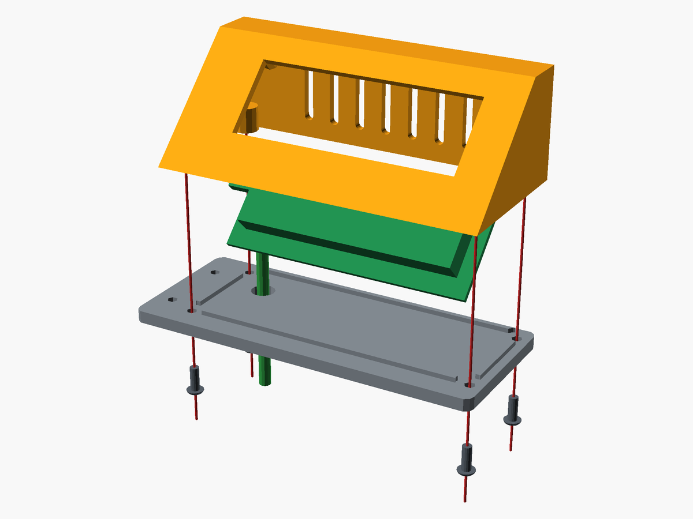
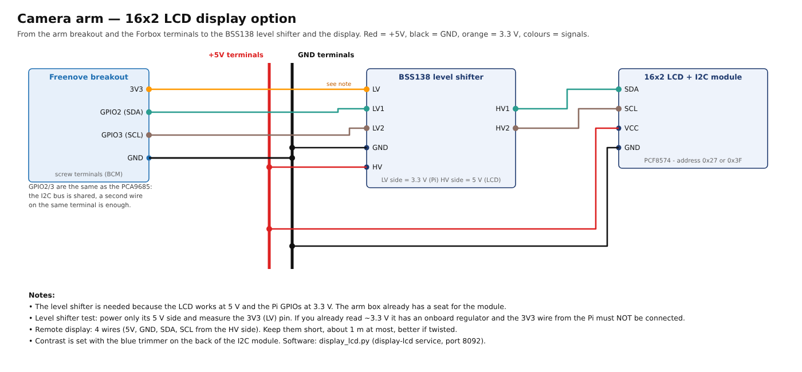

# 16×2 LCD display (optional)

> 📖 **[Article on www.emgi.it (in Italian)](https://www.emgi.it/2026/10/19/braccio-robotico-telecamera-raspberry-pi-stampato-3d/)** (section «Opzione: display LCD 16×2») · [back to the project](../README.md)

A 16×2 I2C LCD display showing the joint positions, the light and the messages from Claude and the controller. It is mounted on the lid of the electronics box, **fixed** (2 screws) or **adjustable** (a single screw, to turn it slightly), after drilling the lid, or **remote** with wires up to about 1 m long.

## Components

- 16×2 HD44780 LCD + **PCF8574** I2C module (address 0x27 or 0x3F), powered at 5 V
- **BSS138** 4-channel I2C level shifter (the LCD works at 5 V, the Pi GPIOs at 3.3 V)
- 3D-printed box (shell + bottom), M3×6 (4) and M3×8 (4) screws, 1-2 M3 screws to fix it
- 4 wires

## Wiring

| From | To |
|---|---|
| GPIO2 (SDA) / GPIO3 (SCL) of the breakout | LV1 / LV2 of the level shifter (same terminals as the PCA9685: shared I2C bus) |
| 3V3 of the breakout | LV of the level shifter, **only if the module does not already have a regulator** |
| +5V terminals | HV of the level shifter, VCC of the LCD module |
| GND terminals | GND of the level shifter, GND of the LCD |
| HV1 / HV2 of the level shifter | SDA / SCL of the LCD module |

⚠️ **Level shifter test**: power only its 5 V side and measure the LV pin. If you already read ~3.3 V it has an onboard regulator: the 3V3 wire from the Pi must not be connected.

## Contents

| Path | Content |
|---|---|
| `stl/display_box/` | Shell and bottom of the box |
| `openscad/electronics_box.scad` | Source (parts `display_shell` and `display_bottom`, in the same file as the electronics box) |
| `docs/display_assembly_guide.html` | Assembly guide with wiring and placement |
| `software/display_lcd.py` + `display-lcd.service` | Display program (port 8092: `GET /lcd?r1=&r2=&sec=`) - see [`software/README.txt`](software/README.txt) |

Quick installation: I2C enabled, `sudo apt install python3-smbus2`, copy `display_lcd.py` to `/opt/braccio/` and the service to `/etc/systemd/system/`, then `sudo systemctl enable --now display-lcd`. Contrast is set with the blue trimmer of the I2C module.
